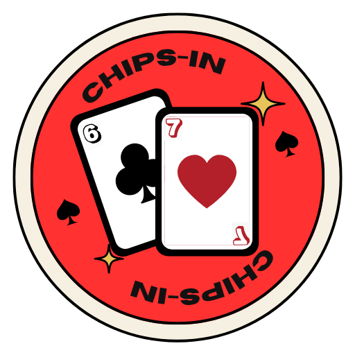

<h1> Chips-in</h1>

[Bahasa Indonesia](README.md) | [English](README.en.md)

A digital chip app for playing **Poker** and **Blackjack** with friends. Create a room, share its code with players, and manage chips and rounds together at one table.

> **Play Chips-in:** [https://online-poker-chips.onrender.com/](https://online-poker-chips.onrender.com/)

Chips-in syncs rooms, players, chips, bets, and game results. Cards are still played physically; the app tracks chips and helps manage the game.

## Features

- Separate rooms with a unique code for each table.
- Poker and Blackjack modes.
- Chip balances, bets, pots, and game history.
- A dealer panel to configure the table and manage players.
- Player management: change seating order, add or remove chips, offer the dealer role, and remove players.
- Players can join with a room code and set up their profile.
- Player and dealer sessions can be resumed after a connection loss, while the room and session are still available.
- Installable as a progressive web app (PWA) on supported browsers and devices.
- Indonesian and English interface, with theme options.

## How to use

### Dealer

1. Open [Chips-in](https://online-poker-chips.onrender.com/) and select **Create Room**.
2. Change your name and choose an avatar.
3. Share the room code with the players.
4. Open **Dealer Controls** to choose Poker or Blackjack, set the starting chips, and—for Poker—set the Small Blind and Big Blind.
5. Manage players in **Dealer Controls**: change seating order, add or remove chips, offer the dealer role, or remove players.
6. Play each round at the table:
   - **Poker:** select **Start New Hand**. When prompted to reveal community cards, reveal them on the physical table, then select **Confirm Cards** in the app. At **Showdown**, select the winner for each pot (including side pots), then select **Award Pot**.
   - **Blackjack:** players place their bets first. Select **Lock Bets & Deal**, then record each player's result after the physical card game. The bulk result buttons resolve all bets with the same result; **Cancel** returns the bets for that round.
7. **Reset All Chips** is available when no round is in progress.

### Player

1. Enter the room code from the dealer, then select **Join Room**.
2. Change your name and choose an avatar.
3. Play according to the selected mode:
   - **Poker:** take your turn by folding, calling/checking, raising, or going all-in. If you run out of chips while all-in, wait for the showdown and for the dealer to award the pot.
   - **Blackjack:** choose chips to set your bet before the dealer deals. During a round, use **Double** or **Split** when available.
4. Chip balances, bets, and room updates are synced automatically.

If your connection drops or the tab closes, reopen the site in the same browser. If the room and session are still available, you can choose to resume as a player or dealer. Players return with their previous balance; a returning dealer resumes their role. A session cannot be resumed if the room is no longer available, for example, after the server restarts.

## Run locally

Follow these steps to run the Chips-in server on your own computer (localhost).

### 1. Install Node.js

Download and install **Node.js 18 or later** from [nodejs.org](https://nodejs.org/). The Node.js installer also includes npm, which is used to run the app.

When installation is complete, open a new terminal and verify both commands are available:

```bash
node --version
npm --version
```

If either command is not recognized, close and reopen your terminal or VS Code after installing Node.js.

### 2. Open the project folder in a terminal

In VS Code, open the `online-poker-chips` project folder and select **Terminal → New Terminal**. Make sure the terminal is in the folder containing `package.json`. If it is not, change to that folder with `cd`, for example:

```powershell
cd "C:\path\to\online-poker-chips"
```

### 3. Start the server

Run this command in the terminal:

```bash
npm start
```

When the server starts successfully, the terminal will show the server address/port. Keep the terminal open while using the app.

### 4. Open the app

Open a browser and visit [http://localhost:3000](http://localhost:3000). The `localhost` address is only accessible from the computer running the server.

To stop the server, return to the terminal and press **Ctrl+C**.

### Troubleshooting

- **`npm` or `node` is not recognized:** make sure Node.js 18 or later is installed, then open a new terminal.
- **Port 3000 is already in use:** start the server on another port. In PowerShell:

  ```powershell
  $env:PORT=3001
  npm start
  ```

  Then visit [http://localhost:3001](http://localhost:3001).
- **The page cannot be opened:** make sure `npm start` is still running and check the terminal for errors.

## Project structure

```text
app/
  Config/
    paths.js
  Controllers/
    RoomController.js
  Views/
    index.html
public/
  assets/
    css/
      app.css
    images/
      poker-felt-pattern.svg
    js/
      state.js
      sound.js
      room.js
      display.js
      i18n.js
      ui-controls.js
      profile.js
      player-row.js
      poker.js
      blackjack.js
      dealer.js
      app.js
    logo/
      logo-main.png
      logo-small.png
    sounds/
      ...
  manifest.json
  sw.js
server.js
package.json
start.bat
```

- `server.js` is the application entry point.
- `app/Controllers/RoomController.js` handles the HTTP server, rooms, and game logic.
- `app/Views/index.html` is the main page.
- `public/` contains stylesheets, browser scripts, images, sounds, the manifest, and the service worker.
- Browser scripts are loaded in order from `app/Views/index.html` because some files use state and helpers defined by earlier files.
- Room data is stored in server memory, so unfinished rooms do not persist when the server process restarts.

## Credits

Created by **Ado, Anoy, Isan, and Kholid**.

Built entirely with the help of AI.
